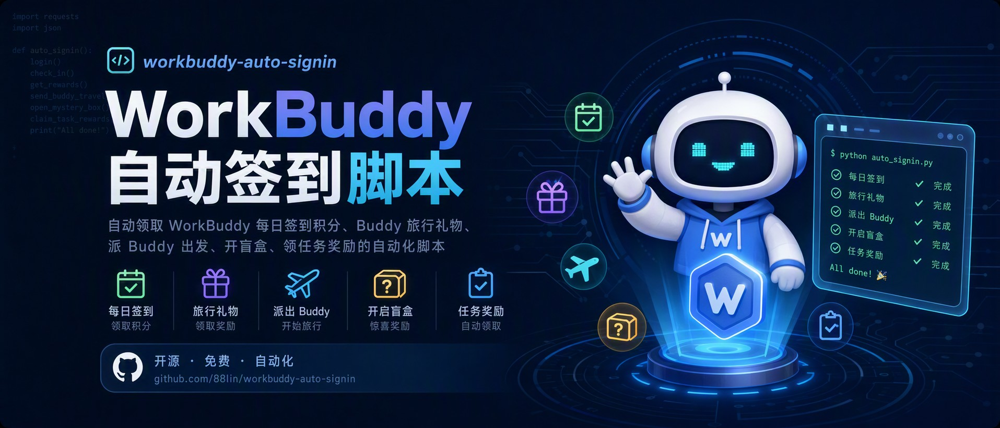

<div align="center">



# 🤖 workbuddy-auto-signin

**自动领取 WorkBuddy 每日签到积分的小脚本**

[](https://github.com/135790135790a/WorkBuddy-/releases)
[](LICENSE)
[]()
[](https://github.com/135790135790a/WorkBuddy-/stargazers)

</div>

> 一个自包含的 Python 脚本，每天自动帮你领取 **WorkBuddy**（腾讯 AI 编程助手）的每日签到积分。只读取你自己机器上的登录态，零内置密钥，可安全分享。
>
> 📦 仓库：[github.com/135790135790a/WorkBuddy-](https://github.com/135790135790a/WorkBuddy-) · ⬇️ 下载：[Releases](https://github.com/135790135790a/WorkBuddy-/releases)

> [!TIP]
> **⭐ 顺手点个 Star 再往下看**——签到接口是从桌面端逆向来的，腾讯改一版它就可能失效，修复都会第一时间推到这里。Star 一下，等哪天连签莫名其妙断了，你能一秒翻回这个仓库。

## ✨ 特性

| | 特性 |
|:---:|---|
| ✨ | **无需额外安装依赖** —— Python 标准库 + 本机 WorkBuddy 自带运行时，不用 `pip install` 或另装 Node；明文凭据只用 Python |
| 📦 | **单文件** —— 完全自包含 |
| ♻️ | **幂等安全** —— 先查状态，未签才领；重复运行不会多领 |
| 🐱 | **成长中心** —— 自动领旅行礼物、派 Buddy、领取新任务、领任务奖、断登自动补登、连登奖励兑换、开盲盒抽奖、能量开 Buddy 盲盒 |
| 🐾 | **成长中心轮询** —— 定时方案自带（Win 一键安装 / macOS 模板）：Buddy 一回来就领礼物并补派，把每日名额用满，不让礼物压到第二天 |
| ⏰ | **双定时模式** —— AI 自动化（跨平台）或系统级静默（Win / macOS，零 token） |
| 📣 | **智能汇报** —— 一行 JSON，如 `成功领取 100 积分（连续 7 天，累计 700 积分）` |
| 💪 | **健壮** —— 兼容明文与受支持的加密凭据，区分格式错误、认证拒绝、权限限制及非签到季 |
| 🌍 | **跨平台** —— 自动探测 Windows / macOS / Linux 凭据文件 |
| 🔐 | **无密钥** —— 仓库不含任何密钥，只读取运行者本机登录凭据 |

---

## 🗂️ 项目结构

仓库一共 51 个文件、约 **1.1 万行 Python**。这里先说清一个容易误解的点：

> **签到本身只需要 `signin.py` 一个文件**，把它单独拷出来照样能跑。其余模块全是"可选增强"——报告、面板、推送、托盘、自愈、监控，缺哪个都不影响签到成功，只是少一项能力。所以叫"单文件自包含"，指的是核心逻辑不依赖同目录其它文件。

下面按功能分组，逐个说明每个文件到底干什么。

### 一、签到核心

| 文件 | 行数 | 职责 |
|:--|--:|:--|
| `signin.py` | 1902 | **唯一入口与主程序**。八个子命令：`auto`（签到+成长中心）、`silent`（同 auto 但写日志不打印）、`growth`、`silent-poll`（轮询补签）、`status`（只查状态）、`doctor`（离线自检，不解密不联网）、`claim`（只领签到）、`all`。内部负责凭据探测（Windows DPAPI / macOS 落盘文件 / Linux CodeBuddy CLI）、签到领取、成长中心全流程（旅行礼物 → 派 Buddy → 领新任务 → 领任务奖 → 断登补登 → 连登奖励兑换 → 盲盒抽奖 → 能量开 Buddy）、按失败类型退避重试，以及 `MAX_BUDGET_SECONDS` / `POLL_MAX_BUDGET_SECONDS` 运行预算上限 |
| `signin_runner.py` | 286 | **外层"整轮运行级"重试**。`signin.py` 内部重试挡不住的情况归它管——机器刚唤醒、网络要更久才就绪、整轮返回异常。它包装"跑一次 `signin.py` 并拿结果"这件事，被 `make-report.py` 和 `test-dashboard.py` 共用，避免两处各写一套重试逻辑 |
| `authheal.py` | 206 | **登录态自愈**。`signin.py` 靠桌面端写出的凭据鉴权，客户端不常开就不续期，token 过期后天天失败。本模块在检测到失效时拉起桌面端 → 轮询等凭据文件刷新 → 允许重试一次 |
| `health.py` | 192 | **凭据健康度预警**。根据 token 签发/过期时间算出"还能撑几天"，在真正断签之前提醒，属于事后自愈（`authheal`）之前的事前防线 |

### 二、状态与持久化

| 文件 | 行数 | 职责 |
|:--|--:|:--|
| `store.py` | 188 | **所有本地状态文件的地基**。提供原子写入（先写临时文件再 `os.replace`）、损坏自愈（坏文件自动备份成 `*.corrupt-*` 并重建）和 schema 迁移。此前全是 `open(w)` 直写，写到一半断电就会把 `signin_history.json` 写成半截 JSON |
| `history.py` | 153 | **签到历史的统一存取**。维护 `signin_history.json`（`_schema: 2`，结构为 `{"days": {"YYYY-MM-DD": {credit, streak, total, result, report}}}`），报告页、总览页、里程碑、分享卡片都从这里取数，保证同一个数字在各处一致 |
| `milestone.py` | 134 | **连签里程碑进度**。面板（`127.0.0.1:8765`）和报告页（`file://`）是两套独立前端，如果各自算连签进度必然算出两个答案。本模块抽出唯一计算源，两边都调它 |
| `heartbeat.py` | 321 | **运行心跳**，回答"任务到底有没有跑"。只靠日志判断会误判：`signin.log` 只在有输出时才写，轮询任务一天跑 6 次、空跑默认不写日志。本模块按计划间隔检测断档，并带告警静默期，防止重复轰炸 |

### 三、报告与可视化

| 文件 | 行数 | 职责 |
|:--|--:|:--|
| `make-report.py` | 1569 | **生成签到报告**。把一次运行结果渲染成完全静态的 HTML（不需要起服务器），内含连签曲线、成长中心明细、壁纸背景、多语言切换（中/英/日）。`python make-report.py` 会先跑一遍 `auto` 再出图，也可以只渲染已有数据 |
| `board.py` | 434 | **「签到总览」页的生成逻辑**。汇总多日历史、连签、成长中心收益，输出 `history.html`。做成静态页而不另起一个服务，是因为定时任务也要调它，纯函数式生成才好复用 |
| `history-page.py` | 32 | **总览页的 CLI 外壳**。生成逻辑在 `board.py`，这个文件只负责"给人用"的部分：打印路径、按需打开浏览器 |
| `archive.py` | 321 | **报告快照归档 + 原始响应留证**。`report.html` 每次生成都原地覆盖，昨天和上周的结果再也找不回来；接口出问题时也拿不到当时的原始返回。本模块按日期留档 |
| `streak-card.py` | 474 | **可分享的连签卡片**（1080×1440 竖版 PNG）。面板、体检、日志都是给维护者看的技术细节，使用者真正能感受到反馈的只有一张图。无数据时也能出图，三位数天数会自动缩小字号 |

### 四、监控与推送

| 文件 | 行数 | 职责 |
|:--|--:|:--|
| `monitor.py` | 454 | **接口失效监测**。`signin.py` 是对桌面端私有接口的逆向实现，对方一改版脚本通常不会报错，而是安静地签到失败。本模块比对响应结构变化，做改版预警 |
| `notify.py` | 470 | **签到结果推送**，支持 7 个渠道：企业微信机器人 / 钉钉机器人 / 飞书机器人 / Bark(iOS) / Telegram / 通用 Webhook / 邮件(SMTP)。配置里的敏感字段用 Windows DPAPI 加密落盘，推送失败静默处理不影响签到 |
| `notify-run.py` | 89 | **计划任务入口**。由 `pythonw.exe notify-run.py <mode>` 调用（无窗口），跑一次签到再按配置推送结果。`mode` 与 `signin.py` 完全一致 |
| `notify-setup.py` | 141 | **一条命令配好推送**。`notify.py` 有 7 个渠道加加密逻辑但配置全靠手改 JSON，本模块做交互式配置并当场发一条测试消息 |
| `rules.py` | 164 | **可自定义的提醒规则**。把原本写死在 `health.py` / `notify.py` 里的阈值（如 7 天、3 天）抽成可配置项，让"什么时候该提醒我"由用户决定 |

### 五、系统集成

| 文件 | 行数 | 职责 |
|:--|--:|:--|
| `tray.py` | 401 | **Windows 系统托盘**（pywin32，无第三方 GUI 依赖）。右键菜单：打开面板 / 立即签到 / 打开报告 / 签到总览 / 生成分享卡片 / 退出；双击图标打开面板 |
| `scheduler.py` | 327 | **计划任务管理**。直接调 Task Scheduler 的 COM 服务（`Schedule.Service`），不依赖 `schtasks.exe`（可能被安全策略禁用），所有操作限定在本项目自己的任务名内 |
| `open-panel.py` | 131 | **一键打开面板**。面板是本地 HTTP 服务（`127.0.0.1:8765`）而非静态文件，双击 HTML 打不开。本脚本检测服务是否在跑，没跑就先拉起来再打开 |
| `browser_open.py` | 50 | **统一打开链接**。优先用 Microsoft Edge，避免 `.html` 被系统关联到其它浏览器导致"每次跳的浏览器都不一样"；找不到 Edge 时退回系统默认浏览器 |
| `test-dashboard.py` | 754 | **可视化测试面板后端**。本地 HTTP 服务，提供 `/run?mode=...` 触发签到、`/status` 查状态、`/api/*` 供前端取数 |
| `test-dashboard.html` | 1733 | **测试面板前端**。配合上面的后端，网页里点按钮就能跑各种模式并实时看输出 |
| `create_shortcut.py` | 41 | 用 pywin32 的 `IShellLink` 创建合法 `.lnk`，目标指向 `pythonw.exe`（无控制台窗口）：双击静默生成报告再自动弹浏览器 |
| `create_panel_shortcut.py` | 39 | 创建桌面「WorkBuddy 面板」快捷方式，指向 `pythonw open-panel.py`，服务没跑会自动拉起 |
| `create_tray_shortcut.py` | 35 | 创建桌面「WorkBuddy 托盘」快捷方式，指向 `pythonw tray.py` |
| `install-windows.ps1` | 195 | **Windows 一键安装**。创建两个计划任务：`WorkBuddyAutoSignin`（每天 00:05 签到+成长中心，静默写 `signin.log`）和 `WorkBuddyGrowthPoll`（每 4 小时补签+成长中心全套）。两者都零 Token、无窗口、开机错过会补跑，可重复执行（幂等） |
| `workbuddy-auto-signin.plist.example` | 99 | **macOS launchd 模板**。`StartInterval` 每 4 小时跑一次完整 `auto`，`RunAtLoad` 在登录时补跑一次，覆盖关机/睡眠期间错过的签到。改掉里面两处占位路径即可用 |

### 六、资源文件

| 文件 | 用途 |
|:--|:--|
| `assets/cover.jpg` | README 顶部封面图 |
| `wallpaper.jpg` | 报告页默认壁纸背景，**可直接替换成你自己的图**，改完重新生成报告即可生效 |
| `wallpaper.default.jpg` | 原版壁纸备份，换图换坏了拿它还原 |
| `tests/fixtures/sym-v1.json` | 加密凭据的**合成测试夹具**（用 Python `cryptography` 独立生成，不含任何真实客户端材料），用于验证 AES-GCM 解密与 AAD 字段拼装 |

### 七、测试

11 个测试模块、158 个用例，全部离线运行，不联网、不启动真实客户端、不创建真实计划任务。

| 文件 | 行数 | 覆盖内容 |
|:--|--:|:--|
| `tests/test_auth.py` | 334 | 凭据解析与鉴权流程：跨平台路径、加密/明文两种格式、各类失败分支 |
| `tests/test_credential_read.py` | 164 | 凭据读取的重试策略：共享读、退避、**"文件被占用"与"无权限"的区分**。针对真实故障——客户端刷新 token 时会独占 `workbuddy-desktop.info`，旧实现只等 3×2 秒，锁稍长就整天断签，且报错让人误判为登录失效 |
| `tests/test_runtime_discovery.py` | 226 | 从 Windows 注册表探测 WorkBuddy 安装位置与版本（用假注册表，不读真实注册表） |
| `tests/test_growth.py` | 268 | 成长中心：补登日期契约、礼物/任务/兑换/抽奖各接口的成功与异常返回 |
| `tests/test_authheal.py` | 139 | 自愈逻辑：判定条件、凭据指纹比较、"客户端已启动 / 未启动 / 启动失败" 各分支（假 launcher + 假 sleeper） |
| `tests/test_heartbeat.py` | 199 | 心跳：间隔计算、断档判定、告警静默期、坏文件不崩。时间全部由调用方注入，不依赖真实时钟 |
| `tests/test_board.py` | 133 | 总览页：数据聚合、HTML 渲染、以及**数据源全挂也不白屏**的兜底 |
| `tests/test_streak_card.py` | 110 | 分享卡片：取数、排版、无数据兜底、三位数天数字号收缩。不测截图（依赖本机浏览器） |
| `tests/test_runner_heartbeat.py` | 97 | `signin_runner` 与心跳的衔接：哪些模式该写心跳、payload 是否带断档信息 |
| `tests/test_notify_setup.py` | 77 | 推送配置：地址→渠道自动识别、配置落盘与回读。不发真实网络请求 |
| `tests/test_install_windows.py` | 200 | 在隔离的 PowerShell 进程里跑真实安装脚本，但挂一个假 `ScheduledTasks` 模块，不创建真实任务也不启动进程 |

### 八、工程配置

| 文件 | 说明 |
|:--|:--|
| `.github/workflows/tests.yml` | CI：在 `ubuntu` / `windows` / `macos` × Python `3.10` / `3.13` 六种组合上跑全部单元测试 |
| `.gitignore` | 排除运行期产物与含本机数据的文件（`signin_history.json`、`monitor_state.json`、`notify_config.json`、`signin.log`、`report.html` 等），避免误提交隐私 |
| `.gitattributes` | 统一换行符处理，防止 Windows 下提交时把 `.sh` / `.py` 的 LF 改成 CRLF |
| `LICENSE` | MIT 协议全文（含原作者版权声明，分发时必须保留） |
| `docs/plans/credential-compatibility-plan.md` | 加密凭据的兼容设计与验证记录 |
| `docs/plans/makeup-compatibility.md` | 补登日期契约的根因分析与回归验证 |

---

## 📋 前置条件

- ✅ 已安装并**登录过 WorkBuddy 桌面端**（登录后自动写出凭据文件，脚本靠它鉴权）；**Linux 没有**桌面端，登录过 [CodeBuddy CLI](https://www.codebuddy.cn) 即可，脚本会自动探测它的凭据
- ✅ 本机有 **Python 3**（任意版本，无需任何第三方包）
- ⬜ 可选：装了 `git` 就能直接 `clone`；没有的话去仓库页面 **Code → Download ZIP** 解压，效果一样

---

## ⏰ 每日定时自动化

本脚本依赖本机桌面端的登录态，因此定时必须跑在本机。提供**两种定时模式**，按需选择：

### 模式对比

| 对比项 | 模式 A：AI 自动化 | 模式 B：系统级静默 ⭐ |
|:---:|---|---|
| **平台** | 🌐 Win / macOS / Linux | 🪟 Win / 🍎 macOS |
| **原理** | WorkBuddy 自动化触发 → AI 模型跑脚本 → 模型汇报 | 系统定时器（Win 任务计划程序 / macOS launchd）直接跑脚本 → 写日志文件 |
| **Token 消耗** | 每次消耗一次模型调用 | **零** |
| **聊天记录** | 每次一条 | **零** |
| **弹窗** | 无 | 无 |
| **可靠性** | 依赖模型可用性 | 纯系统级，更可靠 |
| **日志** | 在聊天记录里 | 独立日志文件（Win `signin.log` / macOS `/tmp/*.out`） |
| **关机错过** | 错过就错过 | 可设「错过后下次启动时补跑」 |
| **设置难度** | 中（clone + 填绝对路径 + 建自动化） | Win 低（一条命令，全自动）／ macOS 中（改模板里的绝对路径） |

### 模式 A：AI 自动化（跨平台）

适合 macOS / Linux，或不想碰任务计划程序的人。由 WorkBuddy 的自动化定时触发，AI 模型跑一次脚本再汇报——**每次会消耗一次模型调用**。

**第 1 步 · 拿到脚本**

```bash
git clone https://github.com/135790135790a/WorkBuddy-.git
cd workbuddy-auto-signin
```

记下 `signin.py` 的绝对路径，第 2 步要用，例如：

- macOS / Linux：`/Users/you/workbuddy-auto-signin/signin.py`
- Windows：`C:\Users\you\workbuddy-auto-signin\signin.py`

**第 2 步 · 新建自动化**

- **名称**：每日自动领 WorkBuddy 积分
- **计划**：每天 00:05
- **提示词**（自动化**每次触发时执行**的那一句）：

  ```text
  运行 <python> <signin.py 的绝对路径> auto，
  把命令输出的 JSON 里 report 字段的内容，直接一句话汇报给我。
  若 JSON 的 needs_attention 为 true 或命令退出码非 0，额外提醒我处理。
  ```

> [!NOTE]
> `<python>` 填你机器上的 Python 3 命令名：macOS / Linux 通常是 `python3`，Windows 通常是 `python`。拿不准就各跑一次 `python3 --version`、`python --version`，哪个有输出用哪个。

> [!TIP]
> **懒人一键**：上面两步都能省——直接把仓库链接丢给 WorkBuddy：
> `帮我把这个仓库跑起来并设置每天 00:05 自动签到：https://github.com/135790135790a/WorkBuddy-`
> 它会自己 `clone`、建好自动化、把绝对路径和 Python 命令名一并填好。（这条是**一次性**的设置指令，和上面那条「每次触发时执行」的提示词不是一回事。）

**想要成长中心轮询？** 再建一条自动化即可：计划设为「每 4 小时」，提示词照抄上面那句（**仍然用 `auto`**）。它会先查签到状态、未签才补，再跑成长中心——所以这条轮询顺带兜住了「00:05 没跑成」的情况；已签过时只是一个查询请求，不会重复领取。

> [!NOTE]
> 模式 A 每次运行会消耗一次 AI 模型调用并产生一条聊天记录。签到逻辑本身是确定性代码，模型仅负责「跑命令 + 汇报」。

---

### 模式 B：系统级静默（推荐）

用系统自带的定时器直接运行脚本，**完全不经过 AI 模型**。Windows 走任务计划程序 + `pythonw.exe`（无窗口 Python），macOS 走 launchd，两边都是零 Token、无窗口。

**第 1 步 · 拿到脚本**（两个系统通用；本地已有仓库就跳过）

```bash
git clone https://github.com/135790135790a/WorkBuddy-.git
cd workbuddy-auto-signin
```

拿到脚本后，按自己的系统往下看即可——**Windows 看下面这节，macOS 直接跳到再下面那节**。

#### 🪟 Windows · 任务计划程序

**第 2 步 · 一键设置**（在仓库目录下运行，`pythonw.exe`、`signin.py` 全都自动探测）：

```powershell
powershell -ExecutionPolicy Bypass -File .\install-windows.ps1
```

它会自动建好两个任务：

| 任务 | 频率 | 干什么 |
|---|---|---|
| `WorkBuddyAutoSignin` | 每天 00:05 | 签到 + 成长中心，静默写 `signin.log` |
| `WorkBuddyGrowthPoll` | 每 4 小时 | 补签（未签才签）+ 成长中心全套 |

两个任务都零 Token、无窗口、关机错过后下次开机自动补跑。装完后终端会打印结果和下次运行时间。

脚本仅在两个任务注册成功、且都能读取到任务和运行信息后显示「完成 / 两个定时任务已就位」。任一步失败都会报告出错阶段和任务名，并以退出码 `1` 结束；若已有部分任务注册成功，会列出并保留，解决问题后重跑即可更新同名任务。

> [!TIP]
> **注册时提示「拒绝访问 / 0x80070005」？** 使用登录 WorkBuddy 的**同一 Windows 账号**，以管理员身份打开 PowerShell，进入仓库目录后重跑安装命令。提权只用于安装，定时任务仍以该账号的普通权限运行。若设备策略禁止注册任务，请联系管理员，或使用上面的「模式 A：AI 自动化（跨平台）」；模式 A 无需 Windows 计划任务，但每次会消耗一次模型调用。

> [!NOTE]
> **为什么要两个任务**：签到一天一次就够了，成长中心却不是——Buddy 出去旅行 1~4 小时就带着礼物回来，礼物得手动领。只靠 00:05 那一次，礼物会压到第二天才到账；万一某天没跑成（关机），当天唯一的派出名额还会整个浪费掉。
>
> **轮询也会补签**：00:05 那次万一撞上关机、睡眠，或者刚开机网络还没就绪，当天就再也没有第二次机会、连签直接断。所以每次轮询都会先查一次签到状态，**未签才补**——已签的情况下只是一个查询请求，代价可以忽略，换来的是一天七次机会。接口幂等，不会重复领取。

> [!TIP]
> 探测不到 Python 时脚本会提示你手动填：编辑 `install-windows.ps1`，把顶部的 `$ManualPythonw` 改成 `pythonw.exe` 的完整路径即可（`$ManualSignin` 同理，一般不用动）。任意 Python 3 自带的 `pythonw.exe` 都行，不限于系统 Python。

**卸载**：

```powershell
Unregister-ScheduledTask -TaskName "WorkBuddyAutoSignin" -Confirm:$false
Unregister-ScheduledTask -TaskName "WorkBuddyGrowthPoll" -Confirm:$false
```

只要签到、不想要成长中心轮询的话，只删第二个就行。

**查看日志**：

```powershell
Get-Content signin.log -Tail 5   # 或用记事本打开
```

日志格式（每行一条 JSON）：

```text
[2026-08-30 10:34:04] {"result": "ALREADY", "report": "今日已签过（今日 +100，连续 16 天，累计 1600 积分）", ...}
```

> [!TIP]
> **懒人一键**：直接把仓库链接发给 WorkBuddy，让它帮你装好——
> `帮我 clone 这个仓库并运行 install-windows.ps1 完成自动签到设置：https://github.com/135790135790a/WorkBuddy-`

> [!NOTE]
> Windows 侧用的是 `silent` / `silent-poll` 参数：结果写入 `signin.log` 而非 stdout，配合 `pythonw.exe`（无控制台窗口）实现完全静默。日志文件路径可用环境变量 `WORKBUDDY_SIGNIN_LOG` 覆盖。
>
> 轮询任务一天要跑好几轮，所以**只有真领到东西或出错时才写日志**；「已签过」「Buddy 还在路上」「今日名额已用完」这类空跑不落盘，免得有价值的记录被淹没。想逐轮查看就设 `WORKBUDDY_GROWTH_LOG_EMPTY=1`。

#### 🍎 macOS · launchd

**第 2 步 · 套用模板**——随仓库提供的 `workbuddy-auto-signin.plist.example`，改掉里面的占位路径就能用：

```bash
which python3                                    # 记下输出，编辑模板时要填
mkdir -p ~/Library/LaunchAgents                  # 首次使用时该目录可能不存在
cp workbuddy-auto-signin.plist.example ~/Library/LaunchAgents/workbuddy-auto-signin.plist
# 编辑该文件：把两处 /PATH/TO/workbuddy-auto-signin 改成脚本目录的绝对路径；
# 若 which python3 的输出不是 /usr/bin/python3，把 ProgramArguments 第一项也一并换掉。然后加载：
launchctl bootout gui/$(id -u)/workbuddy-auto-signin 2>/dev/null
launchctl bootstrap gui/$(id -u) ~/Library/LaunchAgents/workbuddy-auto-signin.plist
```

**查看日志**：正常输出在 `/tmp/workbuddy-auto-signin.out`；跑不起来时先看 `/tmp/workbuddy-auto-signin.err`（Python 报错、权限拒绝都在那儿）。

**卸载**：`launchctl bootout gui/$(id -u)/workbuddy-auto-signin`

> [!TIP]
> **懒人一键**：直接把仓库链接发给 WorkBuddy，让它帮你装好——
> `帮我 clone 这个仓库，并按 workbuddy-auto-signin.plist.example 配好 macOS launchd 定时任务：https://github.com/135790135790a/WorkBuddy-`

> [!WARNING]
> macOS 上有两个坑，踩中都是「任务静默失败、日志空空如也」：
>
> 1. **别想当然地填 `/usr/bin/python3`**——没装 Xcode Command Line Tools 时它只是个占位壳子，命令行里跑会弹安装框，**launchd 里跑则是直接失败**，错误只进 `.err` 文件。Homebrew 装的通常在 `/opt/homebrew/bin/python3`，一律以 `which python3` 的实际输出为准。
> 2. **脚本不要放在 `~/Documents`、`~/Desktop`、`~/Downloads` 下**——macOS 的隐私保护（TCC）会拦截后台进程读取这些目录，报 `Operation not permitted`。推荐放 `~/Library/Application Support/` 或任意普通目录。

> [!NOTE]
> 模板内置三种触发：每天 00:05、每 4 小时、登录时各跑一次。三者跑的都是完整的 `auto`（签到 + 成长中心），所以「每 4 小时」那轮既做成长中心轮询，也顺带兜住「00:05 没开机」的情况。脚本幂等，重复触发不会重复领取。
>
> 日志由 launchd 重定向而来，`auto` 模式**每轮都会追加一行**（不像 Windows 的 `silent-poll` 会跳过空跑），且 launchd 不做轮转。介意体积就定期清空，或把模板里的 `StandardOutPath` 指到你自己管理的路径。

#### 🔁 成长中心轮询说明（两个系统通用）

> [!IMPORTANT]
> **Buddy 旅行有每日名额限制**（服务端返回 `daily_limit_reached`），实测一天只能派出一次。轮询的作用是「及时把礼物领回来 + 补上当天错过的那次派出」，**不是**让你一天刷好几趟——脚本读到名额已用完会直接收手，不会去撞那堵墙。
>
> 轮询同时兼任**签到兜底**：每轮先查一次签到状态，未签就补上（两个系统都是如此，Windows 的 `silent-poll` 与 macOS 的 `auto` 行为一致）。所以「00:05 没跑成」不再等于「这天断签」。

---

## 🛠️ 手动运行（调试用）

想先手动跑一次、确认脚本可用：

```bash
git clone https://github.com/135790135790a/WorkBuddy-.git
cd workbuddy-auto-signin
python signin.py auto
```

看到 `今日已签过` 或 `成功领取 N 积分`，就说明跑通了。

> [!NOTE]
> 下文所有命令都以 `python` 为例。macOS / Linux 上若提示 `command not found`，把 `python` 换成 `python3` 即可。

<details>
<summary>📖 全部命令</summary>

```bash
python signin.py auto           # 签到 + 成长中心（礼物 / 任务 / 补登 / 连登兑换 / 抽奖 / Buddy）
python signin.py silent         # 同 auto，但输出写入日志文件而非 stdout（配合定时任务静默运行）
python signin.py growth         # 仅成长中心（不签到）
python signin.py silent-poll    # 轮询：补签（未签才签）+ 成长中心，空跑不写日志（配合模式 B 的轮询任务）
python signin.py silent-growth  # silent-poll 的旧名，行为完全相同（老计划任务仍可用）
python signin.py status         # 仅查签到状态（调试）
python signin.py doctor         # 离线检查凭据格式及运行时能力，不解密、不联网
python signin.py claim          # 仅领取签到（调试，幂等）
python signin.py all            # 查签到状态 + 领取（调试）
```

</details>

---

## ⚙️ 工作原理

登录后，WorkBuddy 桌面端写出 JSON 会话文件 `workbuddy-desktop.info`。旧版本的 `accessToken` 是明文字符串，新版本可能为 `$wbEncrypted` 字段信封。脚本先校验格式；受支持的 `sym-v1 / suite 1` 信封由本机客户端自带的运行时在隐藏子进程中解密，只通过内存管道返回 access token。脚本不处理 refresh token，登录及续期仍由客户端负责。

| 凭据来源 | 支持情况 |
|---|---|
| Windows / macOS 旧明文、Linux CodeBuddy CLI 明文 | 保留原路径，无需客户端解密运行时 |
| Windows 新版字段加密 | 支持 `sym-v1 / suite 1`；5.6.2、5.7.3、5.8.3 已进行本机解密与只读认证验证，其他版本按格式与运行时能力检测 |
| macOS 新版字段加密 | 已实现 `.app` 可执行文件发现及同一管道协议；尚待客户端实机验证 |
| 其他加密格式或不具备原生存储接口的运行时 | 明确返回 `AUTH_ERROR`，不发送无效令牌 |

客户端升级可能改变私有接口或格式。先运行 `python signin.py doctor` 检查本地能力，再运行只读的 `python signin.py status` 验证服务端认证；`doctor` 成功不表示解密或服务端认证已验证。

Windows 按 `WORKBUDDY_EXE → 默认安装目录 → 注册表` 的顺序发现客户端。只有默认目录找不到时，才读取当前用户和本机的 32/64 位卸载注册条目，支持自定义安装目录、带空格或逗号的路径。注册表权限不足或条目失效会跳过；未登记的安装仍可用 `WORKBUDDY_EXE` 指定路径。注册表探测只读取信息，不修改注册表，也不执行卸载命令。

签到流程：

1. 📂 **定位**凭据文件（自动探测，或用 `WORKBUDDY_AUTH_FILE` 覆盖）
2. 🔍 **查询** `POST /v2/billing/meter/checkin-activity-status` —— 今天是否已领？
3. 🎁 **领取** 若未领，`POST /v2/billing/meter/daily-checkin`
4. 🐱 **成长中心** 领旅行礼物 → 派 Buddy → 领取新任务（进度从领取才开始计）→ 领任务奖 → 断登自动补登（有补登卡时，每轮最多补一天）→ 连登奖励兑换 → 开盲盒 → 能量开 Buddy 盲盒
5. 📤 **输出** 一行 JSON，`report` 字段是人话汇报

补登只从服务端活跃日历中选择**当月、今天之前、活动上线之后且活跃分数为零**的日期，优先补最近的断点，每轮最多用一张卡。`makeup_dates` 是**已补登记录**，这些日期会被排除；日历缺失或格式异常时停止补登并提醒，不推测缺失日期的状态。规则与验证依据见[补登兼容说明](docs/plans/makeup-compatibility.md)。

> [!NOTE]
> 查询请求按网络错误或服务端 5xx 退避重试，次数受时间预算限制；补登、抽奖、领奖等写操作**不**重试，避免超时发生在服务端处理完成之后造成重复提交。两个签到接口例外——状态查询是只读的，领取接口本身幂等（当天重复领取只会返回「已签」，不会再发一次积分），故允许重试。整个运行受时间预算约束，详见「配置」。
>
> 所有请求都打到官方客户端用的同一个 endpoint（`https://copilot.tencent.com`）。签到接口系从桌面端 `app.asar` 逆向得到，仅供个人自动化使用。

---

## 🔧 配置

| 环境变量 | 作用 |
|---|---|
| `WORKBUDDY_AUTH_FILE` | 自动探测失败时，手动指定凭据文件路径 |
| `WORKBUDDY_EXE` | 指定与加密凭据对应的客户端**可执行文件**；Windows 为 `WorkBuddy.exe`，macOS 为 `.app/Contents/MacOS/` 内实际可执行文件。路径错误时直接报告，不静默回退 |
| `WORKBUDDY_SIGNIN_LOG` | `silent` 模式下日志文件路径（默认 `signin.log`） |
| `WORKBUDDY_BUDGET_SECONDS` | 单次运行的网络请求时间预算。签到类命令默认 `420`（7 分钟）、上限 `540`；`silent-poll` / `silent-growth` 轮询默认 `180`、上限 `240`。**Windows 上须为正数且小于对应计划任务的 `ExecutionTimeLimit`**（macOS launchd 无此限制）。非法值、`≤0` 或超上限都会夹到安全值，并在输出里附 `config_warning` |
| `WORKBUDDY_GROWTH_LOG_EMPTY` | 设为 `1`（或 `true`/`yes`/`on`）时，`silent-poll` 连空跑也写日志；默认只在领到东西或出错时记录 |

> [!NOTE]
> 时间预算须小于计划任务的 `ExecutionTimeLimit`。两个任务的时限不同，所以上限也分开算：签到任务 PT10M → 上限 `540`，轮询任务 PT5M → 上限 `240`，各留 60 秒给解释器启动和收尾。网络异常时单个请求最坏要耗 30 秒，若不设上限，接口逐个超时会把任务跑穿被系统强杀——而结果是在最后才写日志的，当天记录会整条丢失。预算耗尽时脚本主动收尾并如实记录，剩余项留到下次。
>
> 若你要调整某个任务的 `ExecutionTimeLimit`，须同步改 `signin.py` 顶部对应的 `MAX_BUDGET_SECONDS` / `POLL_MAX_BUDGET_SECONDS`（分别对应签到任务与轮询任务）。
>
> macOS 的 launchd **没有** `ExecutionTimeLimit` 这类外部时限，不会把跑久了的任务强杀，所以上面的上限只是 Windows 侧的约束；macOS 上脚本内置的时间预算就是唯一的兜底，保持默认即可。

---

## 🧪 排错

| 现象 | 处理 |
|---|---|
| `NO_AUTH / 未找到登录凭据` | 先登录一次 WorkBuddy 桌面端（Linux 则是 CodeBuddy CLI）；或设置 `WORKBUDDY_AUTH_FILE` |
| `NO_AUTH / WORKBUDDY_AUTH_FILE 指向的文件不存在` | 环境变量路径写错了——核对 `looked_in` 字段里的实际路径 |
| `NO_SESSION` | 本地缺少登录会话或必要字段，请先登录客户端 |
| `AUTH_ERROR / INVALID_FORMAT` | 凭据结构或令牌格式无效；先检查凭据来源和客户端版本 |
| `AUTH_ERROR / UNSUPPORTED_ENVELOPE` | 加密格式尚不支持，请更新脚本；反复重新登录不会解决格式不兼容 |
| `AUTH_ERROR / RUNTIME_NOT_FOUND` 或 `INVALID_RUNTIME_PATH` | 检查客户端安装位置，设置正确的 `WORKBUDDY_EXE` |
| `AUTH_ERROR / RUNTIME_UNAVAILABLE` 或 `HELPER_PROTOCOL` | 所选运行时不具备所需能力或返回无效结果，请检查客户端和脚本版本 |
| `AUTH_ERROR / KEY_MISMATCH` 或 `DECRYPT_FAILED` | 检查所选客户端是否与凭据匹配，以及凭据是否完整；多版本安装可用 `WORKBUDDY_EXE` 明确选择 |
| `AUTH_ERROR / HELPER_TIMEOUT` | 凭据助手超时并已停止，稍后重试或检查运行时 |
| `AUTH_REJECTED / HTTP 401` | 服务端拒绝认证；检查客户端登录状态、凭据对应的服务地址及脚本版本，不能仅凭 401 断言过期 |
| `FORBIDDEN / HTTP 403` | 服务端拒绝操作，检查账号权限或活动条件；已知“兑换档位未解锁”仍按正常业务状态处理 |
| `INACTIVE / 签到活动未开启` | 非签到季，属正常，无需处理 |
| `NETWORK / 网络不可达` | 断网或服务端不可用，**非**登录问题。脚本内置退避重试（5/15/30/60/90 秒，受时间预算约束），跨得过"刚开机网络还没就绪"那几十秒；仍失败就等下一次运行 |
| `TIMEOUT / 已达本次运行时间预算` | 网络严重超时导致预算耗尽，已领到的部分照常记录，剩余项下次再领 |
| `ERROR / 登录凭据文件不是合法 JSON` | 本地凭据文件损坏——重新登录一次 WorkBuddy 桌面端即可重建 |
| `ERROR / 脚本运行异常（...）` | 异常不会静默丢失：`silent` 模式会写进 `signin.log`；可重跑 `python signin.py status` 看原始返回 |
| 00:05 那次失败，连签却没断 | 正常——轮询任务（01/05/09/13/17/21 点）会先查状态，未签就补上。补签那轮日志会带 `"trigger": "poll"` |
| 连登兑换「进阶」未解锁（连登天数不足） | 正常——三档分别要连登满 7 / 14 / 28 天，天数不够时服务端返回 403，脚本按常态处理，不记为失败 |
| 旧日志反复出现 `date is not broken, no makeup needed` | 旧版误把已补登记录当作待补日期；更新脚本即可。新版从活跃日历选断点；查询后日期已被补上的情况按正常状态跳过 |
| 查补登日历失败 / 补登模块异常 / 补登失败 | 本轮停止补登，失败原因写入 `report`，并返回非零退出码与 `needs_attention: true`；已领取的签到积分和其他奖励仍保留 |
| `signin.log` 里查不到轮询记录 | 正常——空跑（已签过 / Buddy 还在路上 / 今日名额已用完）默认不落盘。想逐轮查看就设 `WORKBUDDY_GROWTH_LOG_EMPTY=1` |
| 轮询任务一直显示「今日旅行名额已用完」 | 服务端每日只放行一次派出，当天已派过就会这样，属正常。第二天自动恢复 |
| 调试原始返回 | `python signin.py status` 或 `python signin.py all` |

> [!IMPORTANT]
> 需要处理的结果会附 `needs_attention: true`；静默模式也会记录认证错误。成长中心部分步骤成功不会掩盖其他步骤的硬失败，失败原因会同时进入 `report`。`status` / `claim` / `all` 请求失败返回非零退出码，`all` 的状态查询失败时不会继续领取。

---

## 🔐 安全与隐私

- 脚本只读取**你自己本机**的 WorkBuddy 会话文件，不含、不内嵌、不传输任何第三方密钥
- 永远不会打印 `accessToken`，`Authorization` 头不会出现在日志里
- 加密路径的密钥只在短生命周期的客户端子进程内使用；不写临时密钥文件、不缓存明文 token、不改写原凭据
- 凭据助手有独立超时及管道大小限制，受本次运行总时间预算约束；原始助手输出不进入日志
- 可安全 fork、分享、在自己机器上运行——它只作用于**你自己的**登录态

---

## ⚠️ 免责声明

> [!WARNING]
> 本项目为**非官方**工具，与腾讯或 WorkBuddy 无任何隶属关系。签到接口系从桌面端 `app.asar` 逆向得到。使用风险自负；接口可能随时变动且不另行通知。请遵守相关服务条款。

---

<div align="center">

**看到这儿了，说明这脚本大概率对你有用 —— 那就[点个 ⭐ Star](https://github.com/135790135790a/WorkBuddy-) 吧**

一秒的事，却能在接口哪天变了、脚本悄悄失灵时，让你还找得到回来的路。

</div>

---

## 📄 协议

[MIT](LICENSE) © 2026 [88lin](https://github.com/88lin)（原始作者）

本项目基于 [88lin/workbuddy-auto-signin](https://github.com/88lin/workbuddy-auto-signin) 修改，遵循 MIT 协议；按照 MIT 条款，原始版权声明保留于 [LICENSE](LICENSE)。
